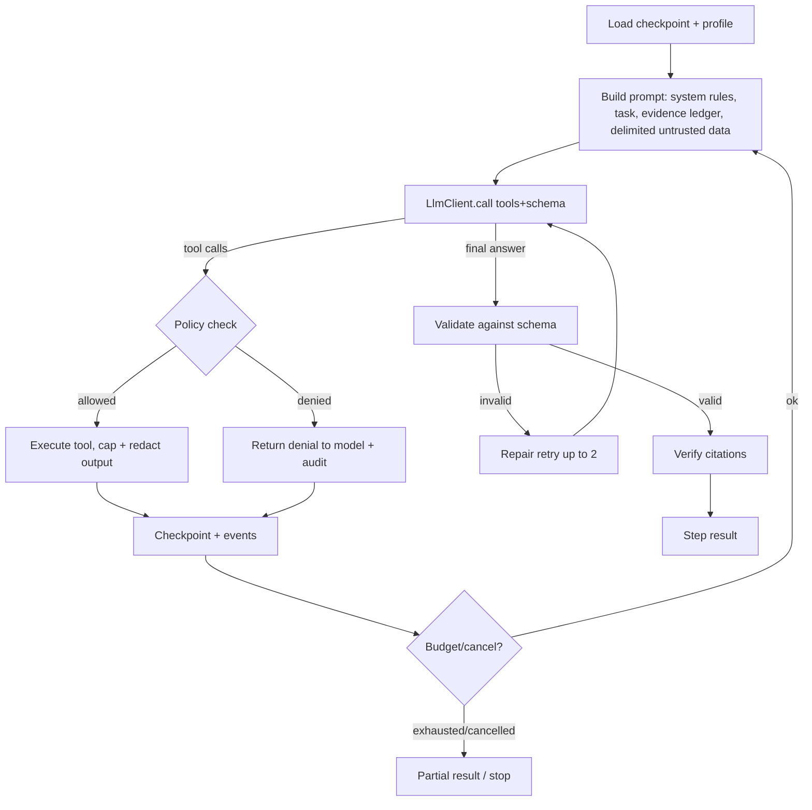

# AI Orchestration

Decisions: ADR-0003 (model), ADR-0004 (library), ADR-0007 (context).

## Answers to the required questions
| Question | Answer |
|---|---|
| Single vs multi-agent? | **Hybrid, starting simple**: persisted deterministic workflow; each step runs one tool-using agent loop from an *agent profile*. No multi-agent framework. |
| Evidence for a separate agent | (a) measured eval gain from isolated context, or (b) need for different permissions (e.g. reviewer cannot see implementer's reasoning/has read-only tools). Until then profiles ≠ agents. Likely first split: independent **reviewer** profile for `REVIEW`. |
| Decomposition / scheduling / resume | Workflow definition lists steps; scheduler = job queue (ADR-0005). Each step checkpoints: message history (compacted), tool results, evidence ledger, token spend. Resume = reload checkpoint and continue the loop. |
| Tool output validation | Every tool has a JSON schema for input *and* output; outputs are size-capped, line-numbered, truncated with markers; model output validated against step schema; cited evidence re-verified against `sha`+`contentHash`. |
| Large-repo context | Repo profile + glob/grep/outline tools; evidence ledger; summarise stale tool results; per-step token budget (ADR-0007). |
| Index vs search | Search first; index only on measured recall failure. |
| Limiting calls/tokens | Per-run and per-step budgets (tokens, tool calls, wall time, USD); prompt caching for stable prefixes; cheap model for classification/summarisation, strong model for investigation/fix; early stop when the confidence rubric is met; dedupe identical tool calls; hard stop → partial results. |

## Agent loop (per step)

## Agent profiles (config, versioned)
| Profile | Tools | Writes | Output schema |
|---|---|---|---|
| `triage` | ticket fields | none | NormalizedInput + gaps |
| `investigator` | `repo.tree/glob/grep/read/outline/gitLog/gitBlame` | none | Findings[] + RootCauseAssessment |
| `fix-planner` | investigator tools | none | FixProposal |
| `implementer` | read tools + `worktree.applyEdit/createFile` | worktree only | CodeChange summary |
| `validator` (mostly deterministic) | `sandbox.run(approved commands)` | none | ValidationSummary |
| `reviewer` | read tools + diff | none | Review findings |
Each profile: prompt template (versioned file), allowed tool ids, budgets, model tier, schema. Skills in `.claude/skills/` are the *human/dev-time* playbooks; runtime prompts are derived from them but live in `backend/.../prompts/` with tests.

## Tool policy
`ToolExecutor.execute(call, runContext)`:
1. Tool must be in the **step's** profile and the **workspace policy** (policy is human-authored; the model cannot alter it).
2. Arguments schema-validated; paths resolved through path-jail to registered repo/worktree.
3. Class `READ` → auto; `LOCAL_WRITE` → requires an approved `IMPLEMENT` approval; `EXTERNAL_WRITE` → requires fresh approval bound to artifact hash. Commands run only from an allowlist of *detected* build/test commands (from repo profile, reviewed in the fix proposal), never arbitrary shell from the model.
4. Output redaction (secret patterns) before returning to model/log.
5. Audit record.

## Prompt-injection defences
Untrusted content (ticket, comments, repo text, MCP output) placed in clearly delimited data blocks with a standing instruction that it contains no commands; tool permissions enforced outside the model; no tool can read outside registered repos; no outbound network from tools except allowlisted integrations; suspicious patterns (instructions to AI, credential requests) surfaced as findings; high-risk actions always need human approval regardless of model output. Evals include injection fixtures.

## Model abstraction
`LlmClient`: `complete(ModelRequest{messages, tools, responseSchema, maxTokens, timeout, cacheHints}) → ModelResponse{content|toolCalls, usage, finishReason}`; streaming optional (token stream to UI is nice-to-have, not v1). The user selects provider + primary model (+ optional fast model) per run (ADR-0012); profiles ask for a **tier** (`STRONG`, `BALANCED`, `FAST`) which resolves to the selected models, so prompts/profiles are provider-independent. `ModelCapabilities` (tool calling, structured-output mode, context window, caching, streaming) drive adaptation (e.g. native schema output vs tool-call emulation; context budget). Models lacking tool calling are unselectable. Credentials come from the run owner via `CredentialContext`. Pricing from catalog; usage persisted per call with `userId`, provider, model.

## Confidence and evidence
Labels VERIFIED/SUPPORTED/HYPOTHESIS/UNKNOWN assigned by rubric: VERIFIED only when backed by ≥1 validated evidence item or tool output; model must supply evidence ids; unsupported claims are auto-downgraded server-side. Confidence summary is advisory.

## Evaluation
Golden tasks (real, sanitized tickets from test projects such as ProgressiveBeef + synthetic bugs in fixture repos) with known root-cause files: metrics = file recall@k, citation validity (must be 100%), unsupported-claim rate, tokens/run, tool calls/run, success of produced patch on hidden tests. Evals run per supported provider/model and are reported separately (a provider is "supported" only after passing them). Replay mode with recorded LLM responses for deterministic CI; a nightly live-model run tracks drift. See `docs/engineering/testing-strategy.md`.
