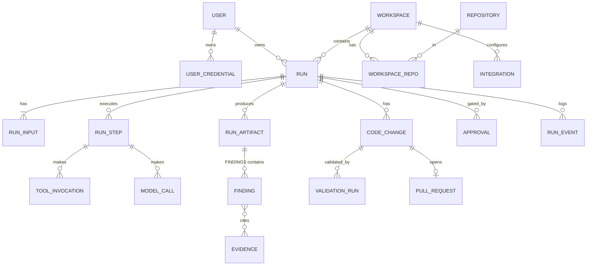

# API and Data Model Proposal

Candidates from the brief were consolidated: `AnalysisRun/AnalysisInput` → generic `Run/RunInput` (ADR-0010); `RootCauseAssessment`, `FixProposal`, `Finding` → typed `RunArtifact` rows (+ a `finding` table because UIs query/filter findings); `TestExecution` → `ValidationRun`; `CodeChange` is the patch/branch record. No separate `Repository`-per-run copies.

## Domain model

Key attributes (all ids UUID; `created_at`, `version` on aggregates):
- **Workspace** (UI: "Project"): name, `kind` (`SUPPORT`; `NEW_PROJECT` reserved, rejected by the API until Phase 2 — resolved through a `ProjectType` registry holding allowed input kinds, workflow definition ids and agent profiles), `policy` (JSON: allowed tools, write permissions, sandbox limits, concurrency, approval rules, retention).
- **WorkspaceRepo** (join): workspaceId, repositoryId, `role` (`BACKEND|WEB_FRONTEND|MOBILE|LIBRARY|OTHER`), `hints` JSON (stack, build/test command overrides, related-repo links such as "frontend X calls backend Y"). A support workspace has 1..N of these.
- **Repository**: name, `localPath` or `remoteUrl`, defaultBranch, `profile` (JSON, cached per `headSha`), `credentialRef`.
- **Integration** (project-level service connections): `port` (`TRACKER`, `GIT_HOST`) + `type` (`JIRA_MCP` now; `BITBUCKET`/`GITHUB`/`GITLAB`/… future), config JSON (no secrets), `secretRef`, status (`UNVERIFIED|CONNECTED|DEGRADED|DISABLED`), `lastCheckedAt`. Status `CONNECTED` is set only by a real health check.
- **User** / **UserCredential** (`identity`): UserCredential = userId, `provider` (`ANTHROPIC|OPENAI|GEMINI`), label, `encryptedSecret` + `keyVersion`, status (`UNVERIFIED|VALID|INVALID|QUOTA`), lastVerifiedAt. Write-only via API; never returned, logged, or exported.
- **Connection** (generalises UserCredential, ADR-0013): userId, `kind` (`AI_PROVIDER|GIT_HOST|TRACKER`), `providerType`, `authMethod` (`API_KEY|PAT|OAUTH`), encrypted secret/refresh token, status, lastVerifiedAt, `providerInstanceId`.
- **ProviderInstance** (admin-editable, seeded from YAML): kind, `adapterType` (code-defined), displayName, baseUrl, enabled, modelPolicy (allow/deny, tier overrides, custom models, pricing), oauthClientId, `secretRef` for client secret.
- **ModelInfo** (catalog; derived, cached): provider, id, displayName, tier, capabilities, contextWindow, pricing?, `available` (per user's credential).
- **Run**: type, status, `idempotencyKey`, `ownerUserId`, `agent{provider, modelId, fastModelId?, credentialId, adapterVersion}` (fixed at creation; changes only at an approval gate and are audited), mode (`INVESTIGATE_ONLY|PROPOSE_FIX|FIX_AND_PR`), budgets, `failure{code,step,retryable}`, repoSnapshots (`repoId`→`baseSha`).
- **RunInput**: kind, `sourceRef` (e.g. Jira key + updated timestamp), `normalized` JSON, `rawHash`. Raw ticket body stored only if workspace policy allows.
- **Evidence**: repoId, sha, path, startLine, endLine, `contentHash`, optional short `excerpt` (≤40 lines), `source` (tool_invocation id), `verified` bool (re-checked against the sha).
- **Finding**: runId, text, `label` (VERIFIED/SUPPORTED/HYPOTHESIS/UNKNOWN), confidence, evidenceIds.
- **RunArtifact**: type (`ROOT_CAUSE`, `FIX_PROPOSAL`, …), `content` JSON validated by schema, `contentHash`, supersedes.
- **CodeChange**: one per (run, repo) — a multi-repo fix yields several, linked by `runId`; repoId, baseSha, branch, `worktreePath`, `patch` (unified diff), `patchHash`, filesChanged stats.
- **ValidationRun**: codeChangeId, command, sandboxProfile, exitCode, status, duration, `logRef`, summary parsed counts.
- **Approval**: runId, kind (`IMPLEMENT|PUSH|PR|JIRA_WRITE`), `artifactHash`, status, requestedBy, decidedBy, decidedAt, comment, expiresAt.
- **PullRequest**: provider, externalId, url, sourceBranch, targetBranch, status.
- **ModelCall**: provider, model, inputTokens, outputTokens, cached, costEstimate, latency, stepId (prompt/response bodies *not* stored by default).
- **AuditEvent** (append-only): actor, action, target, details JSON, ip, ts.

## Persistence classification
| Persist | Derived / cacheable | Do not store |
|---|---|---|
| runs, inputs (normalized), steps, events, findings, evidence refs, artifacts, patches, approvals, validation summaries, PRs, usage, audit | repo profile (per SHA), search results, outlines, diff stats, SSE feed (from events), cost totals | secrets/tokens, full prompts & raw model responses (opt-in debug with TTL), full repo copies in DB, raw large logs in DB (file store w/ TTL + redaction), attachments' binary content unless policy permits |

Retention (default, configurable): events/artifacts 180 d, logs 30 d, debug transcripts 7 d, audit 1 y.

## REST API (v1, `/api/v1`, JSON, problem+json errors, OpenAPI at `/v3/api-docs`)
| Method & path | Purpose |
|---|---|
| `GET /project-types` | available types with `enabled` flag (SUPPORT enabled; NEW_PROJECT `enabled:false`, "coming soon") |
| `GET/POST /workspaces` (body: `name`, `kind`), `GET/PATCH /workspaces/{id}` | manage projects and policy; `kind≠SUPPORT` → 422 `PROJECT_TYPE_NOT_AVAILABLE` |
| `GET/POST /workspaces/{id}/repositories` (body: source, `role`, `hints`), `PATCH/DELETE …/{repoId}`, `POST …/{repoId}/refresh` | register 1..N repos **by clone URL** (body: `url`, `connectionId`, `role`, `hints`) or local path, compute profile |
| `GET/POST /workspaces/{id}/integrations`, `POST …/{id}/verify` | configure and health-check |
| `GET /workspaces/{id}/tickets/{key}` | preview normalised Jira issue (read-only) |
| `POST /workspaces/{id}/runs` (header `Idempotency-Key`) | create run → 202 |
| `GET /runs?workspaceId&status`, `GET /runs/{id}` | list / detail incl. state & next actions |
| `GET /runs/{id}/events` | SSE (`Last-Event-ID`); `?after=` polling variant |
| `GET /runs/{id}/findings`, `/artifacts`, `/changes/{cid}/diff`, `/validations` | results |
| `POST /runs/{id}/actions/{continue|request-fix|cancel|resume|answer}` | user-driven transitions |
| `GET /runs/{id}/approvals`, `POST /approvals/{id}/decision` | approve/reject (body includes `artifactHash`) |
| `GET /evidence/{id}/source` | server re-reads file at sha for the viewer (path-jailed) |
| `GET /usage?workspaceId` | token/cost summary (per user and project) |
| `GET/PUT/DELETE /me/connections[/{id}]`, `POST …/{id}/verify`, `GET /me/connections/oauth/{providerInstance}/start` + callback | the caller's own AI / Git / tracker connections: **write-only** secrets; returns only status/label/lastVerified |
| `GET/POST/PATCH/DELETE /admin/provider-instances` (admin role) | add/update/disable/remove AI-provider, Git-host and tracker instances (base URL, model policy, OAuth app); audited; removal is soft when in use |
| `POST /workspaces/{id}/repositories/probe` (body: clone URL, connectionId) | detect host type, verify read access with the user's connection, return default branch + preview of detected build tool/toolchain |
| `GET /agent-providers`, `GET /agent-providers/{provider}/models` | providers and models available to *this user* (credential configured, workspace policy allows, capabilities sufficient), with tier, context window, price hints |

```json
// POST /api/v1/workspaces/{ws}/runs
{ "mode": "INVESTIGATE_ONLY",
  "inputs": [ { "kind": "TICKET", "tracker": "JIRA", "ref": "PB-1234" } ],
  "repositories": ["8f1c…", "d94a…"],
  "agent": { "provider": "ANTHROPIC", "model": "<id from /agent-providers/ANTHROPIC/models>", "fastModel": null },
  "notes": "Seems to happen only for export > 1000 rows" }
// 202
{ "id": "5b2e…", "status": "CREATED", "links": { "events": "/api/v1/runs/5b2e…/events" } }
```
```json
// finding
{ "id": "…", "label": "VERIFIED",
  "text": "ExportService.buildCsv loads all rows into memory before streaming",
  "confidence": "HIGH",
  "evidence": [ { "repo": "pb-backend", "sha": "a1b2c3d", "path": "src/main/java/.../ExportService.java",
                  "startLine": 88, "endLine": 112, "verified": true } ] }
```
```json
// POST /api/v1/approvals/{id}/decision
{ "decision": "APPROVE", "artifactHash": "sha256:…", "comment": "OK, minimal change" }
```
Contract is validated in CI (OpenAPI generated from code, diffed, and consumed by the typed frontend client).
