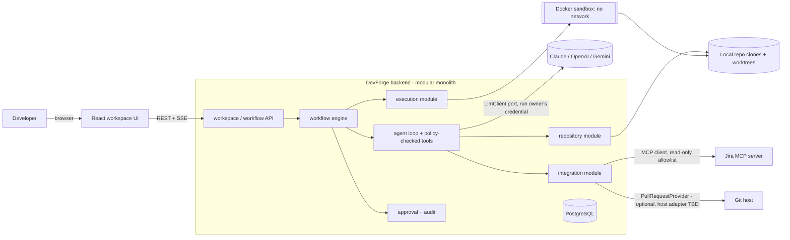
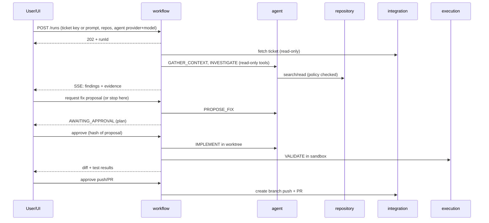

# System Overview

## Discovery findings (2026-10-22, verified)
| Fact | Implication |
|---|---|
| `DevForge-AI/` contains only the source prompt (`fisrt-prompt.txt`); not a git repo | Greenfield; no backend/frontend exists. Nothing to preserve. `git init` deferred to user. |
| Local: Java 21.0.2, Node 22 / npm 10, Docker 29, git 2.53; **no** Maven, Gradle, psql | Use Maven Wrapper; PostgreSQL via Docker Compose; Testcontainers feasible |
| Host: 14 cores, ~29 GB RAM (≈2 GB free at inspection), Linux | Sandbox concurrency must be capped low locally |
| Sibling `../pb-admin-react` = ProgressiveBeef admin portal: webpack, antd 6, karma tests, remote on Bitbucket (`folio3/pb-admin-react`; hosting is *not* a product assumption), has its own `CLAUDE.md` | Real first target. Its stack ≠ ours → platform must detect build tools, not assume Vite/Maven. Git host adapter is an open decision (Q4). Repo-local `CLAUDE.md` must be honoured as untrusted-but-useful guidance |
| ProgressiveBeef backend (per user: Bitbucket, Gradle build) not on this machine | Irrelevant to the design: users supply repo links; it is only a possible test fixture. Gradle must be a first-class detected build tool |
| Atlassian MCP server is registered in this Claude Code environment; **connection not verified** | Do not claim Jira works until spike M0-S2 |

## Context

## Modules and responsibilities
| Module | Owns | Depends on (public API only) |
|---|---|---|
| `identity` | users, roles, authn, **per-user AI credential vault** | — |
| `workspace` | Workspace, repo registration, policy, settings | identity |
| `repository` | clone/worktree mgmt, profile, search/read/diff/patch ops, path-jail | workspace |
| `integration` | Integration config, MCP client, Jira adapter, Git provider adapters, secret resolution | workspace |
| `workflow` | Run, RunInput, steps, state machine, job queue, events, SSE feed | workspace |
| `agent` | LlmClient port + per-provider adapters, model catalog, prompts, agent profiles, tool registry, context/evidence ledger, budgets | repository, integration, execution (via ports) |
| `execution` | Sandbox port, validation runs, log capture | repository |
| `approval` | Approval requests/decisions, policy evaluation | workspace, identity |
| `audit` | append-only audit events | all (listens to events) |
| `platform` | config, errors, web infra, observability, ids/clock | — |

Rule: `workflow` orchestrates; `agent` never changes run state directly—it returns step results. Tool calls always pass `approval`'s policy evaluator.

## Primary data flow (Phase 1 run)

## Execution model
HTTP returns immediately; a worker leases the job and runs steps; every step persists events; UI follows via SSE (resume with `Last-Event-ID`) or polling. See `scalability-and-reliability.md`.

## Extension points (exist now) vs deferred
| Now | Deferred (Phase 2 / scale) |
|---|---|
| Ports: `LlmClient`, `TrackerClient`, `PullRequestProvider`, `Sandbox`, `JobQueue`, `SecretResolver`, `RunInput.kind`, `RunArtifact.type`, agent profiles & workflow definitions as data | `TraceLink`, document/Figma ingestion, requirements/architecture artifacts, task-plan generation, broker, microVM sandbox, code index, multi-agent sub-investigations |
