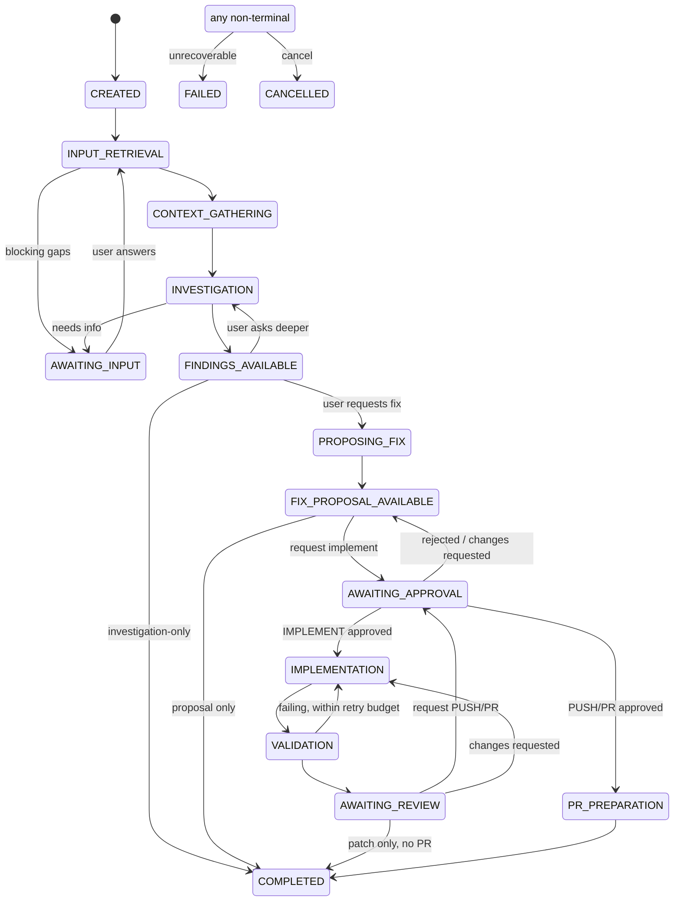

# Workflow State Machine

Run status is the single source of truth; changed only by `RunStateMachine` (domain class), with optimistic locking. Not every run visits every state. Run `type` selects the allowed path.

## States
| State | Meaning | Active worker? |
|---|---|---|
| `CREATED` | accepted, queued | no |
| `INPUT_RETRIEVAL` | fetching/normalising ticket or prompt | yes |
| `AWAITING_INPUT` | blocked on user clarification (added; needed for ambiguity handling) | no |
| `CONTEXT_GATHERING` | repo profile, anchors, initial search | yes |
| `INVESTIGATION` | agent loop, read-only tools | yes |
| `FINDINGS_AVAILABLE` | findings + evidence ready; run may stop here (investigation-only) | no |
| `PROPOSING_FIX` | fix planning (worker) — modelled as step state | yes |
| `FIX_PROPOSAL_AVAILABLE` | proposal ready for review | no |
| `AWAITING_APPROVAL` | an `Approval` of kind `IMPLEMENT`, `PUSH`, or `PR` is pending | no |
| `IMPLEMENTATION` | edits in isolated worktree | yes |
| `VALIDATION` | build/tests/static analysis in sandbox | yes |
| `AWAITING_REVIEW` | diff + results ready for human review | no |
| `PR_PREPARATION` | branch push + PR creation (approved external write) | yes |
| `COMPLETED` | terminal success (incl. investigation-only completion) | no |
| `FAILED` | terminal failure; `failure_code`, `failed_step`, retryable flag | no |
| `CANCELLED` | terminal, user/system cancelled | no |

Every run has one `ownerUserId`; LLM-consuming transitions (`INVESTIGATION`, `PROPOSING_FIX`, `IMPLEMENTATION`, review steps) require the owner's valid credential. `AWAITING_APPROVAL` carries `pendingApprovalId` and `resumeState`.

## Transitions

Guard rules: `IMPLEMENTATION` requires an approved `IMPLEMENT` approval whose `artifactHash` equals the current proposal hash; `PR_PREPARATION` requires approved `PUSH`/`PR` bound to the current diff hash; editing the proposal or diff invalidates approvals.

## Failure and recovery
| Failure | Handling |
|---|---|
| LLM 429/5xx/timeouts | backoff retry ×3 at call level; step fails → `FAILED(retryable=true)`, user "Resume" re-enters the failed step from checkpoint |
| MCP/Jira down | `INPUT_RETRIEVAL` fails with `INTEGRATION_UNAVAILABLE`; UI offers paste-ticket (prompt mode). No fabricated data |
| Credential missing/invalid/expired or provider quota exhausted (`AUTH_INVALID`, `QUOTA_EXHAUSTED`) | no auto-retry; run → `AWAITING_INPUT(reason=CREDENTIAL)` and notifies the **run owner**, who fixes the key (or switches model at the gate) and resumes from checkpoint; if the owner is deactivated, run is `CANCELLED` |
| Token/step budget exhausted | agent returns partial findings → `FINDINGS_AVAILABLE` with `incomplete=true` and unknowns listed |
| Invalid structured output | repair retry ×2, then fail step |
| Citation validation fails | claim downgraded to HYPOTHESIS; not a failure |
| Validation fails | up to N (default 2) fix attempts in `IMPLEMENTATION↔VALIDATION`, then `AWAITING_REVIEW` with failures shown |
| App restart | lease expiry re-queues; step resumes from last checkpoint; non-idempotent externals (push/PR) use a recorded intent + provider-side existence check before retry |
| Cancel | flag checked between tool calls; sandbox container killed; worktree retained for inspection until TTL; → `CANCELLED` |
| Duplicate submit | `idempotency_key` → returns existing run |
| Approval timeout | approvals expire (default 7 d); run stays awaiting, then `CANCELLED` by policy sweep |

Every transition appends a `run_event` and an `audit_event` (actor: user | system | agent-step).
