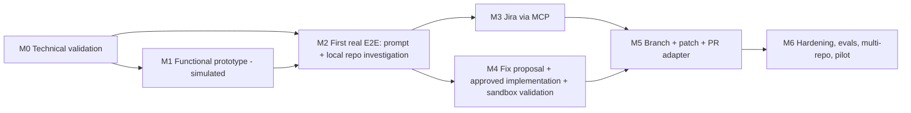

# Implementation Plan — Phase 1 (detailed), Phase 2 (outline)

## Estimation assumptions
2 engineers (one backend-leaning, one frontend-leaning) with Claude Code assistance, ~full time; ranges are **calendar weeks** and widen where M0 findings are pending. **Re-baseline after M0.** Not included: procurement of API keys/access, security review lead times, ProgressiveBeef-specific build fixes (major unknown, R3).

## Milestone overview

| Milestone | Est. | Nature |
|---|---|---|
| M0 | 1-2 wks | spikes, no product code retained except harness |
| M1 | 3-4 wks | **Functional prototype**: real UI/API/DB/workflow engine, **simulated** agent |
| M2 | 3-5 wks | **First real end-to-end**: real LLM, real repo, read-only investigation |
| M3 | 1-2 wks | Jira MCP |
| M4 | 4-6 wks | fix → approval → worktree → sandbox |
| M5 | 2-3 wks | local branch + patch, then PR adapter for the chosen Git host |
| M6 | 3-5 wks | hardening + pilot |
| M2b | 2-3 wks | OpenAI + Gemini adapters, provider parity evals (after M2 proves the port) |
Phase 1 total: **~21-33 weeks** (low confidence until M0 completes; the AI-provider/credential scope added ~4-6 weeks over the earlier 17-27 estimate).

## M0 — Technical validation (spikes; each ends with a written result in an ADR)
**Status 2026-10-22: executed — see `docs/engineering/spikes/m0-results.md`. S1/S2/S3/S4 partly verified (no live AI key, Docker unavailable, headless Jira auth unverified); S5 deferred (host unchosen).** Outstanding inputs listed there.
| Spike | Question | Done when |
|---|---|---|
| S1 | Spring AI vs LangChain4j vs direct SDKs behind `LlmClient` with **Claude, OpenAI and Gemini**: tool-call interception, usage, schema output, cancel, **per-request user credentials**, live model listing | ADR-0004 finalised with a runnable demo on ≥2 providers; gaps per provider documented |
| S2 | Can the backend connect to the Jira MCP server (auth, tool list, `get issue`)? Which server? | Real call returns a real ticket, tool schemas recorded; or documented blocker |
| S3 | Sandbox: build+test representative fixtures offline in Docker — a Gradle Spring backend, a Maven Spring backend, a webpack/karma React app, a Vite React app | Commands, image, cache strategy, time & memory measured |
| S4 | Direct-search investigation quality: run 5 real past tickets manually with the tools (as a script) to judge recall and token use | Baseline numbers; decides on outline/index priority |
| S5 | Git-host PR creation for the host the product owner selects (Bitbucket, GitHub or GitLab): branch push + PR with a scoped token on a throwaway repo | Verified calls or blocker. Skipped until Q4 is answered; not blocking M1-M4 |
Risks addressed: R1, R2, R3, R4, R6.

## M1 — Functional prototype (simulated agent) · 3-4 wks
Goal: prove UX, API contracts, persistence, workflow/state machine, SSE; **no real LLM or Jira**; UI marks simulated data.
| # | Task | Depends | Acceptance |
|---|---|---|---|
| 1.1 | Repo scaffold: `backend/` (Boot, Maven wrapper, Modulith verify, Flyway, Testcontainers), `frontend/` (Vite, TS strict, Tailwind, shadcn, Router, Query), `docker-compose.yml` (postgres), `.env.example`, CI workflow, `.gitignore` | — | both builds green; gates BE-1/BE-2/FE-1 run |
| 1.2 | `platform`: problem+json errors, MDC logging, config, health | 1.1 | error contract tests |
| 1.3a | Provider registries: `ProviderInstance` table + YAML seed, admin API/UI (add/update/disable/remove), adapter-type registry; `Connection` generalisation (AI/Git/tracker) with API-key/PAT; repo probe-by-URL | 1.3 | admin can add an OpenAI-compatible instance without code change; removing an in-use instance is soft; probe verifies access with the user's connection |
| 1.3 | `identity`: local-dev auth profile + role model (OIDC wiring stub); **user AI-credential vault** (envelope encryption, write-only API, verify, rotate) | 1.2 | authz matrix test; vault tests: no secret in logs/DTOs, rotation, wrong-user access denied |
| 1.4 | `workspace`: Workspace (with `kind`) + `ProjectType` registry (SUPPORT enabled, NEW_PROJECT disabled), Repository CRUD with roles/hints (1..N), path validation, repo profile (detector registry: Gradle, Maven, npm/yarn/pnpm, webpack, Vite; toolchain/JDK detection) | 1.2 | profile tests on 3 fixture repos; creating NEW_PROJECT returns 422; a project with backend + frontend repos persists roles |
| 1.5 | `workflow`: Run/RunInput/RunStep/RunEvent, `RunStateMachine` full transition table, job queue with leases, worker pool, cancel, idempotent create | 1.2 | exhaustive transition tests; kill-and-resume test; duplicate submit test |
| 1.6 | `agent` ports + **model catalog + provider/model selection API**, `ScriptedLlmClient` / simulated step handlers emitting realistic findings/evidence against fixture repo | 1.5 | scripted run reaches every state incl. failure paths |
| 1.7 | `approval` + `audit` modules (hash-bound approvals, append-only audit) | 1.5 | tests: wrong hash rejected, edit invalidates, audit written |
| 1.8 | REST API v1 + OpenAPI snapshot + SSE endpoint | 1.4-1.7 | contract gate API-1 |
| 1.9 | Frontend: app shell, **project-type chooser + multi-repo setup wizard, "My AI providers" page, agent provider/model selector (fake provider in M1)**, run list, new-run (multi-repo select), run detail (timeline, findings, evidence drawer, approvals, diff viewer), settings; typed client; `useRunEvents` | 1.8 (can start against MSW mocks after OpenAPI draft) | Playwright smoke flow; axe checks |
**Deliverable:** demo of full lifecycle on simulated data; documented API; passing CI. **Exit:** stakeholder UX review.

### M1 status — built 2026-10-22
All tasks delivered except where noted. Evidence: backend **114 tests** (real PostgreSQL via Testcontainers), frontend **47 tests**, and a **real-browser end-to-end test** against the real backend; `scripts/verify.sh`.

| Task | Result |
|---|---|
| 1.1 scaffold | `backend/` (Boot 4.1.2, Maven wrapper, Flyway, Modulith verify), `frontend/` (Vite 8, React 19, TS 5.9 strict, Tailwind 4), `docker-compose.yml`, `.env.example`, `scripts/verify.sh`. **Not done:** a CI workflow file (Git host undecided, Q4) — `verify.sh` is the host-neutral gate |
| 1.2 platform | problem+json with stable codes, request ids, redaction, error-contract tests |
| 1.3 identity | local dev sign-in (**local profile only**; OIDC not built), AES-256-GCM vault bound to connection+owner, key versions + rotation, write-only API |
| 1.3a registries | provider instances (admin add/update/disable/remove), adapter-type registry, unified per-user `Connection`. **Deferred to M2:** repo probe-by-URL / clone (managed clones) |
| 1.4 workspace | project types (Support enabled, New project disabled), 1..N repos with roles/hints, detectors for Gradle/Maven/npm-yarn-pnpm (+toolchain), read-only SHA-pinned git access, denylist, path jail |
| 1.5 workflow | state machine (exhaustive test vs. independent table), DB job queue with leases, workers, cancellation, idempotent create, restart recovery, gapless events, SSE |
| 1.6 agent | `LlmClient` port + scripted double, model catalog and selection rules, `AgentSteps` seam with a labelled simulation |
| 1.7 approval/audit | hash-bound approvals, separation of duties, expiry, rollback when the run cannot honour a decision; append-only audit (DB trigger) |
| 1.8 API | OpenAPI snapshot gate + response-conformance test; 37/43 schemas declare required fields |
| 1.9 frontend | everything listed in the task, plus admin providers/audit pages |

**Deviations from the design (decided during build):** (1) persistence uses `JdbcClient` + records, not JPA (ADR-0005 note); (2) Modulith convention: a module's *root package* is its public API and `internal` is hidden (not an `api/` subpackage); (3) TypeScript pinned to 5.9 because `openapi-typescript` does not yet support 6; (4) oxlint instead of ESLint; (5) default backend port 9090 (8080/9090 are commonly taken).

**Known limitations of M1 (by design or not yet done):**
- The agent is a **simulation**: no model, no Jira, no sandbox execution, no PR. Validation results are `SIMULATED` ("not executed"), never `PASSED`. `PR_PREPARATION` exists in the state machine but no path reaches it.
- Repositories are registered by **local path** and read from git objects (never the working tree, never written). Clone-by-URL and managed worktrees are M2.
- Lexical search quality is the M0 baseline. On a real ticket against a real 2,000-file backend the changed class was **not** in the top 3 (test files are now down-ranked). Real investigation quality is an M2 deliverable.
- Auth is dev-only (header trust). Not safe beyond a developer machine; OIDC is M6.
- Cost is "not available" (model prices unknown); token counts are simulated.
- UI polish: the "Ask for changes" box sits above the tabs; no route-level code splitting yet (one 450 kB / 135 kB gzip bundle).
- E2E is not run in CI (no CI host yet); run `scripts/verify.sh --e2e` locally.

## M2 — First real end-to-end (prompt mode, real repo, real LLM, read-only) · 3-5 wks
| # | Task | Depends | Acceptance |
|---|---|---|---|
| 2.1 | Managed clone + worktree service, path-jail, denylist, ripgrep/git tools with caps | M1 | security tests: traversal, symlink, denylist |
| 2.2 | `LlmClient` port finalised + **first real provider adapter (user's choice; default Claude)**, per-user credential resolution, live model listing, usage ledger, budgets, retries/timeouts, cancel, credential-failure → `AWAITING_INPUT` | M0-S1, 1.3 | adapter contract suite passes on fake server; run uses only owner's credential (test); budget enforcement test |
| 2.3 | Agent loop, `investigator` profile, prompt templates, tool executor with policy | 2.1, 2.2 | injection fixtures: 0 violations |
| 2.4 | Evidence ledger + citation verifier + label downgrade; **multi-repo runs**: per-repo tool scoping, repo role in prompts, cross-repo seam tracing (frontend API call ↔ backend route) | 2.3 | citation validity = 100% on replay evals; fixture with backend+frontend repos where the root cause spans both is traced correctly |
| 2.5 | Eval harness: recorder/replayer, 5+ golden cases (fixtures + 2-3 sanitized real PB bugs) | 2.3 | AI-1 gate in CI (replay) |
| 2.6 | UI: remove "simulated", show real findings/evidence/usage; budgets & cost display | 2.3 | manual run on a real PB repo; E2E with replay LLM |
**Deliverable:** investigate-only runs on a real project repo (ProgressiveBeef first) with verified citations. **Exit:** M0-S4 baseline met or improved; decision on indexing.

## M2b — Provider parity · 2-3 wks
OpenAI and Gemini adapters via `integration-adapter` skill; catalog tiers; capability-driven adaptation (schema output, context budgets); eval replay + live per provider/model; "supported providers" matrix published. **Accept:** AI-3 gate met for each provider offered in the UI; providers that fail stay hidden/disabled.

## M3 — Jira via MCP · 1-2 wks
3.1 `integration` MCP client + health/verify + tool discovery + allowlist (read-only) · 3.2 `TrackerClient` Jira adapter + tracker-neutral normaliser (`ticket-analysis` schema) + injection flags · 3.3 UI ticket preview + gap questions (`AWAITING_INPUT`) · 3.4 failure paths (down, 401, not found, malformed) with fake MCP server tests. **Accept:** real ticket fetched and normalised (verified, not mocked); degraded mode works.

### M3 status — built 2026-10-22 (verified against a local fake MCP server; **not yet against Atlassian's real service**). Gate: backend 174 tests (1 skipped), frontend 54, `scripts/verify.sh` green
| Task | Result |
|---|---|
| 3.1 MCP client | Minimal Streamable-HTTP client on the JDK `HttpClient` (handshake, session id, `tools/list`, `tools/call`, JSON or event-stream replies, JSON found after a leading notice). Hard read-only allowlist inside the client: write tools cannot be called even if asked. Real verifier (handshake + tool listing). Chosen over the MCP SDK to avoid dependency/Jackson churn |
| 3.2 tracker port + adapter | `Trackers`/`Ticket`/`TrackerException` (tracker-neutral; no emails/avatars; routine-comment flag; bounded sizes), Jira adapter, site resolution (several sites need a project setting) |
| 3.3 product flow | per-project tracker setting (`GET/PUT/DELETE /workspaces/{id}/tracker`, admin), ticket preview (`GET /workspaces/{id}/tickets/{key}`), a ticket run without pasted text is read in `INPUT_RETRIEVAL` with the **run owner's own** connection; title taken from the ticket; UI: tracker card, preview, paste-instead |
| 3.4 failures | rejected credential → `AWAITING_INPUT(CREDENTIAL)` and resume re-reads; not found / not configured / ambiguous site → ask for the pasted text; down or malformed → 3 attempts then `FAILED(TRACKER_UNAVAILABLE, retryable)`. Nothing is ever invented |
| tests | 6 client tests, 9 end-to-end workflow tests, 4 UI tests, new ArchUnit rules (MCP code only inside the adapter; only `TicketFetcher` may reveal a tracker secret), OpenAPI snapshot |

**Not verified / open:** Atlassian's real endpoint (it answers 401 + an OAuth challenge when unauthenticated; whether it accepts an API token as Basic/Bearer is **unverified**; OAuth is the documented route and is not built, R19); real tool names/shapes on `v2` (the fake follows what the v1 tools returned in M0); the markdown description is passed through as text rather than parsed into sections.
**How to try it for real:** add a Jira (via MCP) connection under My connections with `email:api-token` (or a bearer token) and press Verify. If it says VALID, set the project's tracker (People & policy), then start a run "From a ticket" with only the key. If Verify says invalid, Atlassian does not accept that credential type on this endpoint: paste the ticket text instead and tell me what it answered.

### M4 status — in progress (2026-10-23): execution foundation + real fix pipeline built; verified against a scripted model and a stub test runner, **not against the live API or real Gradle/Maven builds**. Gate: backend 203 tests (1 skipped), frontend 55, `scripts/verify.sh` green
| Task | Result |
|---|---|
| 4.1 fix planner | `fix-planner-v1` prompt + `submit_proposal`; the server rejects invented paths, secret files, unknown repos, undeclared build/CI edits and sends the model back to repair (≤2 times) |
| 4.2 approval gating | unchanged gate (approval bound to the proposal hash); real runs may now use PROPOSE_FIX / FIX_AND_PATCH |
| 4.3 edit tools + patch | `WorkCopy` (private `git archive` export, baseline commit, exact-once `edit_file`, `create_file`, path-jail, symlink refusal, size limits, protected build/CI files only if the approved proposal named them, secret files never). The implementer may edit **only the files the approved proposal lists** (mutation-checked). Patch = `git diff` of the copy; re-applied to a clean copy for validation |
| 4.4 sandbox | `Sandbox` port + **bubblewrap** backend (rootless; no network except the dependency step; host paths hidden; scrubbed env; CPU/process/file-size limits; timeout kills the whole namespace; output capped and credential-scrubbed). 8 conformance tests (EXEC-1), network-isolation mutant caught. **Docker backend not built**: Docker was unreachable here (Docker Desktop stopped, no docker-group access); memory limits therefore are **not enforced** yet |
| 4.5 validation | `Validator`: dependency step (network, lockfile-driven, into a per-repo cache) then offline test step; recipes for gradle, maven, npm, yarn, pnpm and a self-contained `script` tool; JUnit XML totals (DTD off); `NOT_RUN` (with the reason) when nothing could be verified, never a pass; failed validation loops back to implementation ≤3 attempts with the failure output in the prompt |
| 4.6 reviewer agent | **Not built** (the human review step exists; an automated diff-review agent is future work) |
| 4.7 multi-repo | one private copy, patch and validation per repository, same approval |
| 4.8 UI | fix modes enabled for real models; validation shows counts, failing tests, NOT_RUN, build output collapsed |
| tests | 6 real-mode fix-pipeline workflow tests (scope enforcement, repair of bad proposals, validation-failure retry, no-change failure, NOT_RUN honesty, key isolation, user checkout untouched, token accounting), 9 work-copy tests, 6 validator tests, ArchUnit rule (repository code only runs via the validator) |

**Not verified / open:** a real model's fixing quality and cost; real Gradle/Maven builds (the opt-in `ToolchainSmokeTest` ran the **npm** recipe on a dependency-free project, which proves plumbing and toolchain mounting but not real downloads); the dependency step's network use is unrestricted (an allow-listed proxy per ADR-0006 is not built); Tier 2 tests that need containers are reported NOT_RUN; Docker backend and memory limits; the toolchain must be installed on the server and listed in `devforge.execution.toolchain-mounts` (Gradle/Maven are not bundled); golden "bug-fix" evals (≥3 patched bugs) need a live key.
**How to try it for real:** `DEVFORGE_AGENT_MODE=real`, add a toolchain mount for your JDK/Node if they live outside /usr (see `application.yml`), register a repository, start a *fix and patch* run, approve the proposal, review the diff and checks. Repositories are only read (`git archive`); all edits and builds happen in `<tmp>/devforge-work`.

## M4 — Fix proposal → approval → implementation → validation · 4-6 wks
4.1 `fix-planner` profile + FixProposal schema · 4.2 approval gating UI/flow (IMPLEMENT) · 4.3 worktree edit tools (`applyEdit`), patch + hash · 4.4 `Sandbox` Docker adapter (conformance tests EXEC-1), deps-warm step, command allowlist from repo profile · 4.5 `ValidationRun` parsing (JUnit XML/karma/npm output), fix-retry loop (≤2) · 4.6 `reviewer` profile + diff-review step · 4.7 multi-repo change sets (one worktree/branch/validation per repo, cross-repo ordering e.g. backend first) · 4.8 UI: per-repo diff viewer, validation results, changes-requested loop. **Accept:** ≥3 golden bugs patched with sandbox-validated tests; no network in sandbox proven; no write without approval proven.

### M5 status — host-independent export built; **GitHub publishing built** (2026-10-23), verified against a fake GitHub API and a local bare repository, **not against github.com**
| Task | Result |
|---|---|
| 5.1 branch/commit | Without writing to anyone's checkout: a suggested branch name (`devforge/<ticket>-<slug>`), a `git am` mbox patch per repository authored by the run owner (subject with ticket key, summary, `Refs:`, check result, `Generated-by` trailer). A test applies it with real `git am` on a fresh clone and gets the same tree |
| 5.2b patch export | `GET /runs/{id}/export` (plan + warnings) and `GET /runs/{id}/changes/{id}/export.patch` (download); available once the change awaits review or is accepted; simulated changes are refused |
| 5.3 secret scan | patch lines added are scanned; credentials (private keys, sk-/AKIA/ghp_/xox/AIza/bearer tokens, secret-by-name files) block the export, credential-looking assignments warn; findings name file and rule, never the value |
| 5.4 PR description | deterministic (no model): problem and cause with verified evidence cites, changes, a checks table that says "not run" when nothing ran, review notes, out of scope |
| UI | "Take this change with you" panel: branch, per-repo download and `git switch -c … / git am …` commands, copyable PR text, warnings |
| 5.2 GitHub adapter | `GitHosts` port + GitHub adapter (REST API + git over HTTPS) with the user's own **personal access token** (verified with `GET /user`). **OAuth not built**. The token is sent only to the configured API host and, for pushes, only to the matching git host; a repository whose `origin` points elsewhere is refused (`HOST_UNSUPPORTED_REMOTE`). Push credential travels in the git process environment, never on a command line or URL |
| 5.3 push/PR approval | the run owner asks (`POST /runs/{id}/publish`); the plan (every patch hash, branch, PR title and body, commit time) is an artifact; an approver approves exactly that hash (`PR` approval, existing hash binding and different-approver policy); only then does anything leave the platform. Always a **draft** PR; nothing is merged |
| 5.5 idempotency | one `publication` row per change (intent record); commit is deterministic (fixed time, real base commit as parent) so a retried push is a no-op; an existing open PR for the branch is reused; the branch is never force-pushed; `Try again` after a failure |
| tests | 4 end-to-end publishing tests (approval gating, rejection, failed PR step then retry with no duplicate, foreign host never gets the token), history-preserving copy test (the first version pushed a synthetic root commit; a test caught it) |

**Not verified / open:** github.com / GitHub Enterprise behaviour (fine-grained token permissions, branch protection, rate limits); the publication runs on an in-process thread after approval, so a server restart mid-publication leaves it PENDING until someone presses *Try again*; if the base commit contains local commits that were never pushed, the pushed branch carries them too; OAuth; Bitbucket/GitLab adapters (the port is host-neutral).
**How to try it for real:** create a GitHub token that can push and open pull requests on the repository (classic: `repo`; fine-grained: Contents + Pull requests read/write), add it under My connections (GitHub) and press Verify; run a fix, then on the Changes tab press *Ask to publish*; an approver approves the plan; the draft PR link appears.

## M5 — Branch + patch + PR adapter · 2-3 wks
5.1 Branch/commit service (safe naming, protected-branch denylist, no force) · 5.2 OAuth flow for the first Git host (after PAT works) · 5.2b branch/patch export (host-independent, ships first) then `PullRequestProvider` adapter for the host chosen in Q4 (others later) · 5.3 push/PR approval flow bound to patch hash + secret scan of diff · 5.4 PR description generator (traceable: ticket, evidence, real test results) · 5.5 intent-record idempotency for push/PR. **Accept:** branch + patch produced per repo with no host configured; with an adapter, PR created on a test repo after approval; rejected push handled; retry doesn't duplicate.

## M6 — Hardening and pilot · 3-5 wks
Resource limits/quotas and sweepers, retention jobs, observability dashboards, OIDC, security review (threat-model walk-through, dependency/SAST gates), eval expansion (≥20 cases) and nightly live runs, docs/runbook, pilot with 2-3 engineers on real tickets; collect acceptance metrics from `phase-1-requirements.md`.

## Cross-cutting tasks
CI pipeline; secret/dependency scanning; docs & ADR upkeep; skills refresh from lessons learned.

## Technical risks (see risks doc for full register)
LLM investigation quality on legacy code (R1) · MCP/Jira access (R2) · sandbox feasibility for PB builds (R3) · token cost (R4) · data-sharing approval (R5) · framework churn (R6).

## Definition of ready for M1
Open questions Q1-Q3 answered or defaulted as stated in the risks doc; ADRs 0001-0003, 0005, 0009-0011 accepted.

### M2 status — built 2026-10-22 (verified against a scripted provider; **not yet against the real Claude API**). Gate: backend 158 tests (1 skipped: the live-API eval, opt-in), frontend 50, `scripts/verify.sh` green
| Task | Result |
|---|---|
| 2.1 managed clone + worktree | **Deferred** (blocked on the Git-host/credential decision, Q4). Local-path, SHA-pinned, read-only access from M1 is what M2 uses |
| 2.2 real adapter | Claude adapter via LangChain4j (fresh client per call, per-call credential, vendor retries off, provider-neutral error mapping incl. "credit balance too low"), real key verification, live model list, usage tokens, per-call timeout, credential failures pause the run. 12 contract tests against a scripted server |
| 2.3 agent loop | `InvestigationLoop` + `RepoToolbox` + prompt `investigator-v1`; limits, wrap-up, cancellation, repair/nudge, dedupe; 13 tests incl. a model that obeys planted instructions (every escape refused, secret never reaches the model) |
| 2.4 evidence/multi-repo | unchanged verification + shared `EvidenceJudge`; cross-repo tracing is the model's job per the prompt (evaluated by the multi-hop golden case) |
| 2.5 evals | 6 golden cases, replay gate in the build, live harness (`LiveEvalTest`) that runs only with `ANTHROPIC_API_KEY`; both mutation-checked |
| 2.6 UI | real vs simulated shown honestly, investigate-only gating, incomplete-run notice, token usage |
| extra | named job queues; ArchUnit rules; real-mode end-to-end workflow test (7 tests: key isolation, 401 pause/resume with a replacement key, 429 retry, outage failure, budget → incomplete, model picker) |

**Not verified / open:** real-service behaviour and cost; prompt quality; whether lexical `repo_search_files` suffices on large repos (R24); clone-by-URL; Gemini/OpenAI (M2b); the "M0-S4 baseline met" exit criterion needs a live run (`LiveEvalTest`, then a real ticket).
**How to try it for real:** `DEVFORGE_AGENT_MODE=real` in `.env.local`, restart, add your own Claude API key under My connections, press Verify (it makes one free model-list call), then start an *Investigate only* run. Cost appears only as token counts (prices are unknown to the platform).
